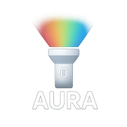

# Aura Lamp 🌈✨



A beautiful Flutter application that brings ambient lighting to your device with multiple visual modes.

## Features 🎯

Aura turns your screen into a soft ambient light. There are no visible controls: the light takes the whole screen and everything is done with gestures.

| Gesture | Effect |
| --- | --- |
| Swipe up / down | Intensity (screen brightness). Below ~15 % the light dims further into a night light |
| Swipe left / right | Warmth, from 1800 K candle amber to 8000 K cool white |
| Double tap | Back to neutral white at full intensity |

A thin indicator and the current value appear only while you swipe, then fade away. The gesture hints are shown once, on first launch. Your last intensity and warmth are remembered.

The app runs in immersive full screen (status and navigation bars hidden) and keeps the screen awake while it is open.

## Technical Details 🔧

### Built With

- **Flutter** / **Dart**

### Key Dependencies

- `screen_brightness`: control the device screen brightness
- `keep_screen_on`: keep the light on while the app is open
- `shared_preferences`: remember the last settings and the onboarding
- `flutter_localizations`: English, French and Spanish

## Building 🛠️

```sh
flutter pub get
flutter build apk --release
```

The APK is written to `build/app/outputs/flutter-apk/app-release.apk`.

On Windows, `build_apk.bat` runs the same two steps and writes the output to `build_apk.log`. It runs from its own folder and uses `flutter` from your `PATH`, or `%FLUTTER_ROOT%\bin\flutter.bat` if `FLUTTER_ROOT` is set.

Run the checks with `flutter analyze` and `flutter test`.

## Contributing 🤝

1. Fork the repository
2. Create a feature branch: `git checkout -b feature-name`
3. Commit changes: `git commit -am 'Add feature'`
4. Push to branch: `git push origin feature-name`
5. Submit a pull request

## License 📄

This project is licensed under the MIT License - see the LICENSE file for details.

## Acknowledgments 👏

- Flutter team for the amazing framework
- Material Design for UI guidelines
- Contributors to the open-source packages used

---

Made with ❤️ using Flutter
